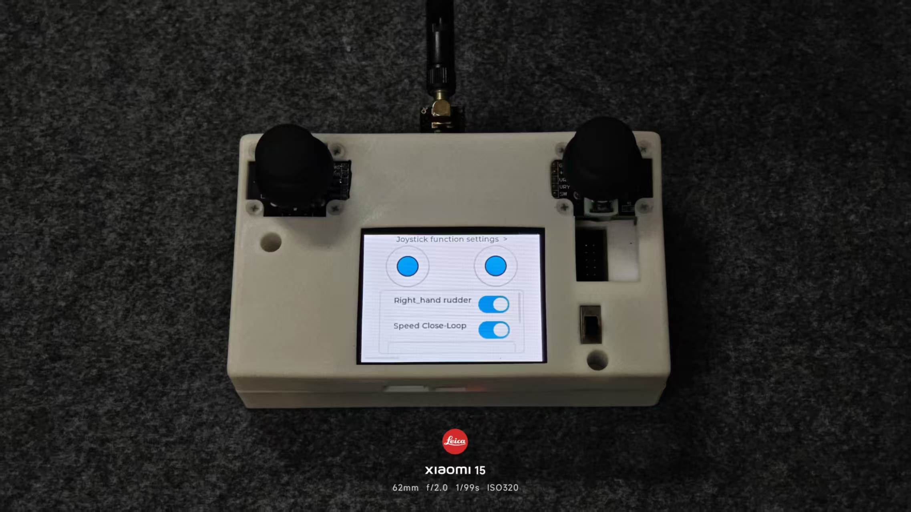
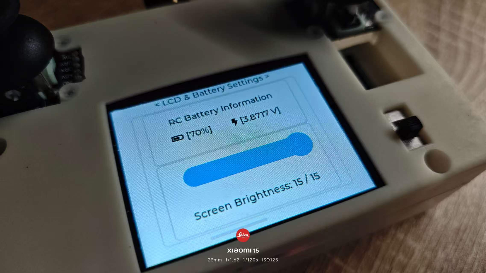
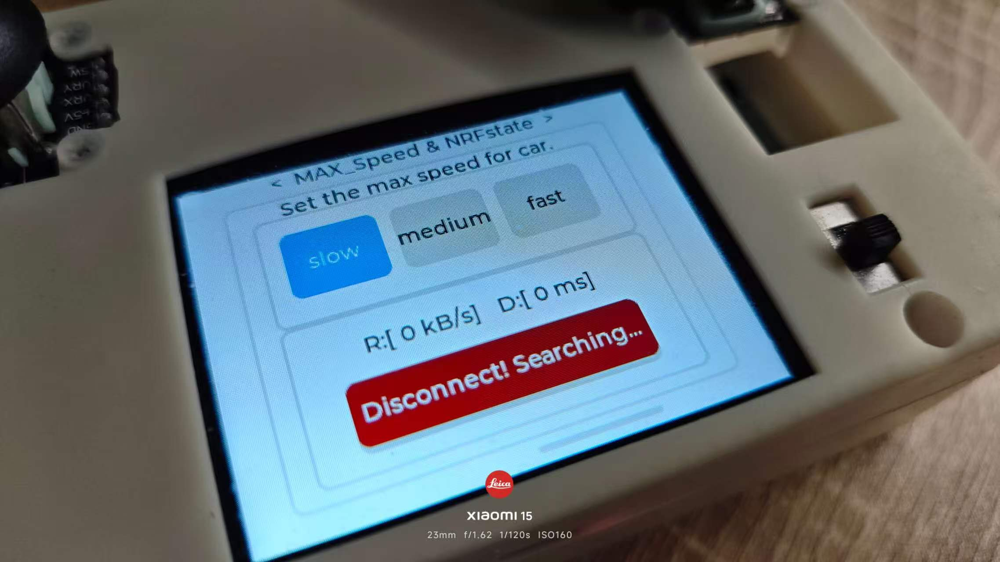
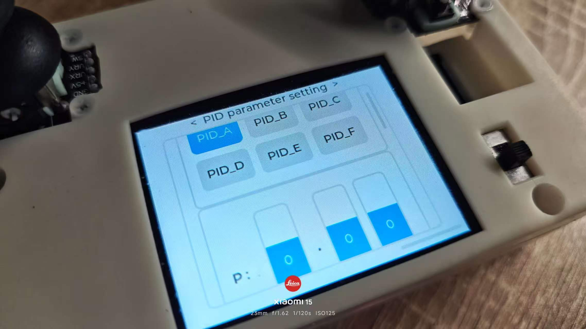

# LVGL 无线遥控器（STM32F407VET6）

基于 **STM32F407VET6 + LVGL 8.3.11** 的双摇杆 2.4 GHz 无线遥控器。3.2 寸 ILI9341 触摸屏提供图形化操作界面，通过 NRF24L01 实时向小车 / 被控端发送摇杆量与控制标志，并支持在线设置 PID 参数、速度档位、屏幕亮度，同时监控电池电量与无线链路状态。

## 主要功能

### 1. 摇杆设置（首页）

- 双摇杆位置实时采样与显示，摇杆按下时对应底座变红
- `Right_hand rudder`：左右手摇杆功能互换
- `Speed Close-Loop`：速度闭环开关
- 左摇杆按下接管控制、右摇杆按下释放控制
- 上电自动采集中位值并做方向 / 增益校准

<p align="center">
  
</p>

### 2. LCD 与电池设置

- 电池电压采样（中值滤波 + 滑动均值滤波），换算并显示电量百分比、电压值
- 电量图标随剩余电量变化
- 滑块调节屏幕背光亮度（1 ~ 15 级，TIM4 PWM 输出）

<p align="center">
  
</p>

### 3. 最大速度与 NRF 状态

- 三档最高速度：`slow` / `medium` / `fast`
- 界面预留无线传输速率 `R:[kB/s]` 与通信延迟 `D:[ms]` 显示（统计功能待接入）
- 显示无线连接状态：`Connected~` / `Disconnect! Searching...`

<p align="center">
  
</p>

### 4. PID 参数设置

- 6 组 PID 通道：`PID_A` ~ `PID_F`
- 每组 P / I / D 通过三个数字滚轮输入（0.00 ~ 9.99）
- `Synchronize` 按钮将当前通道参数写入参数缓存，并记录待同步通道
- 切换通道时自动回显已保存的参数

> 当前 PID 参数仅保存在本地参数缓存中，通过无线下发 / 回读的功能尚未接入。

<p align="center">
  
</p>

> `Ladar_Point_map.c`（雷达散点图）和 `TileView_Parameter_List.c`（PID 参数总览）为预留页面，当前未挂载到主界面。

## 通信协议

- 收发芯片：NRF24L01+，SPI3 接口，中断接收
- 射频参数：2.476 GHz（通道 76）、2 Mbps、0 dBm、5 字节地址 `34 43 56 65 78`
- 自动应答 + 自动重发（500 μs 间隔，最多 10 次）
- 发送周期：100 ms（10 Hz），帧命令字 `0xAA`，负载 9 字节

| 字节 | 内容 |
| :---: | --- |
| 0 ~ 1 | 左摇杆 X（int16，大端） |
| 2 ~ 3 | 左摇杆 Y（int16，大端） |
| 4 ~ 5 | 右摇杆 X（int16，大端） |
| 6 ~ 7 | 右摇杆 Y（int16，大端） |
| 8 | bit4 左摇杆按下 · bit3 右摇杆按下 · bit2 速度闭环 · bit0~1 速度档位 |

接收端使用相同的通道、地址与速率即可解析；发送成功 / 重发超限通过 NRF 的 IRQ 引脚更新连接状态。

## 硬件资源

| 模块 | 型号 / 接口 | 说明 |
| --- | --- | --- |
| MCU | STM32F407VET6 | 168 MHz，HSE 20 MHz |
| 显示屏 | ILI9341 3.2" 320×240 | SPI2 + DMA，双缓冲 |
| 触摸 | FT6336G 电容触摸 | I2C1，INT 外部中断 |
| 无线 | NRF24L01+ | SPI3，IRQ 外部中断 |
| 摇杆 | 4 路电位器 | ADC1 扫描 + DMA（PA2 / PA3 / PA4 / PB0） |
| 电池检测 | 电阻分压 | ADC1_IN1（PA1） |
| 摇杆按键 | SW_L / SW_R | PD3 / PD2 外部中断 |
| 背光 | TIM4_CH1 | PD12 PWM |
| 调试日志 | USART3 | 115200 8N1，环形缓冲发送 |

## 软件结构

```
├── Core/            STM32CubeMX 生成的 HAL 初始化、main、中断
├── Hardware/        ADC / 摇杆、电池电压、NRF24L01、串口日志
├── Screen_Driver/   ILI9341 LCD、FT6336G 触摸、SPI 中断回调
├── lvgl/            LVGL 8.3.11 内核、移植层与 GUI 页面
│   └── GUI/         摇杆、电池、无线状态、PID 四个界面
├── Middleware/      RingBuffer 环形缓冲区
├── zrCMD/           命令表框架（预留，处理函数待实现）
├── 资源/            实物与界面照片
├── 20260114_Remote.ioc   STM32CubeMX 工程文件
└── Debug/ Release/       构建输出目录
```

## 编译与烧录

1. 使用 **STM32CubeIDE** 导入本工程（`File → Import → Existing Projects into Workspace`）。
2. 选择 `Debug` 或 `Release` 配置编译。
3. 通过 ST-Link 下载到开发板。
4. 如需修改外设或引脚，打开 `20260114_Remote.ioc` 重新生成代码（注意保留 `USER CODE` 区域）。

## 使用说明

- 上电时请保持两个摇杆处于中位，系统会以此时 ADC 值作为零点校准。
- 屏幕设置项（亮度、速度档位、PID 参数等）**掉电不保存**，重启后恢复默认值。
- 被控端需将 NRF24L01 配置为相同通道（76）、地址（`34 43 56 65 78`）和 2 Mbps 速率。
- 串口日志位于 USART3（115200），可用于查看初始化与运行信息。
